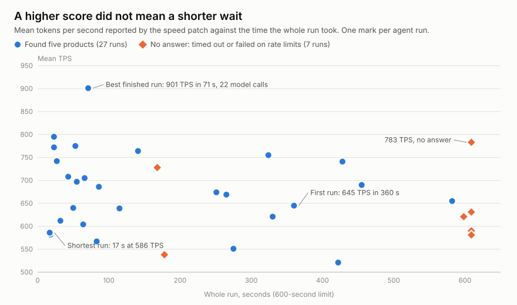

# The model wrote for 6.6 seconds. The run took 6 minutes.

> Written during the Cerebras × Kimi K3.1 Pro × OpenClaw hackathon, November 21–22, 2026. Every number comes from our own saved runs (thirty-four agent runs, six recorded catalog runs, direct API calls, one extraction prototype, rehearsals on another model and the same model on two other providers) or from what other participants posted in the Cerebras Discord, and is labeled as such. **Open:** marks something we did not get to measure. Nothing here is a demonstrated improvement. This post is still being edited.

We asked an OpenClaw agent running Kimi K3.1 Pro on Cerebras to find five real Christmas gifts on real shopping sites. It did: five Barnes & Noble product pages, each one opened and checked.

The whole process took 360 seconds. The eight model responses account for 6.6 seconds of server-side generation.

That is 1.8% of the run. The other 98% was everything else: startup, queueing, network, and 32 web fetches. We do not have that part broken down, so we will not blame any single piece of it. This post is about what tokens per second measures, what it leaves out, and what happened when we spent an afternoon and an evening trying to move the number.

## What we ran

- OpenClaw at commit `8b18b55`, with the official Speed Bounty patch (repo commit `e40e9f7`), applied unmodified. Its numbers were cross-checked call by call against OpenClaw's own trajectory export on several runs and matched exactly.
- Model `moonshotai-kimi-k3.1-pro-trial`, reasoning `low`, temperature 1, max 4,096 tokens per call. `low` is the lowest setting the model accepts: the provider's documentation says Kimi K3.1 Pro always reasons, and a participant who tried `none` got it rejected. Reasoning tokens count as output tokens in every TPS figure here.
- One tool: `web_fetch`. No search API, no preloaded products.
- A prompt that asks for exactly five verified products and tells the agent to report failure instead of filling gaps.
- A 600-second limit per run. Every run starts from fresh state.
- The output cap was never the limit: across 213 assistant messages in the stored runs, none stopped for length, and the longest was 1,013 tokens.

## One run, four speeds

The first run made eight model calls:

| Call | Output tokens | Generation time | TPS |
|---:|---:|---:|---:|
| 1 | 92 | 0.216 s | 427 |
| 2 | 391 | 0.674 s | 580 |
| 3 | 457 | 0.619 s | 739 |
| 4 | 524 | 0.918 s | 571 |
| 5 | 444 | 0.473 s | 940 |
| 6 | 695 | 1.646 s | 422 |
| 7 | 676 | 0.723 s | 935 |
| 8 | 722 | 1.324 s | 545 |
| **Total** | **4,001** | **6.591 s** | |

Four different "speeds" come out of those eight calls:

| How you compute it | Result |
|---|---:|
| Mean of the per-call TPS (what the patch reports) | 645 |
| Total tokens / total generation time | 607 |
| Best single call | 940 |
| Tokens / wall-clock time of the run | 11 |

All four are honest. They answer different questions. The first three describe the chip. The last one describes what a person sitting in front of the agent would feel.

The event itself uses more than one of them. The patch reports the mean of per-call rates from server timing. The bounty post defines TPS as `(output tokens − 1) / (last token time − first token time)`, a client-side streaming formula, and asks for your "top TPS". In the hackathon chat, one participant divided tokens by wall-clock time and got 1.9 to 123 tokens per second on the same model. The demo video kit Cerebras published for this hackathon quotes Kimi at up to 2,000.

Output length does not explain the spread. Call 6 produced 695 tokens at 422 TPS; call 7 produced 676 tokens at 935. Call 1 (92 tokens) and call 6 (695 tokens) landed at almost the same speed.

## What the number leaves out: the wait

Queue time is not in the TPS denominator. During kickoff, participants reported about 100 seconds of queue for replies that took under 0.2 seconds to generate, plus 429 errors. One posted three consecutive measurements: 63 to 107 seconds before the first token on Kimi, 0.27 seconds on a different model with the same key in the same minute, and 885 to 913 tokens per second once the stream started.

We measured it ourselves with three calls straight to the API, no agent and no tools:

| Direct call | Queue | Generation | Output tokens | TPS |
|---|---:|---:|---:|---:|
| 1 | 41.2 s | 4.6 s | 1,059 | 228 |
| 2 | 77.5 s | 5.0 s | 1,206 | 239 |
| 3 | 70.9 s | 3.9 s | 993 | 252 |

All three succeeded; none was a 429. In the second and third, the queue was about 94% of the server's total time. The headline number stays healthy while the experience is slow.

Two caveats. The patch does not store queue time per call, so we have no queue numbers for the agent runs themselves, only for these direct calls. And these three calls asked for about 600 words of prose, which is a different workload from an agent's short tool-calling turns; their 228 to 252 TPS is not comparable to the agent means below.

## Thirty-four runs

We started by repeating the baseline, then changed one thing at a time.

- **12k context**: cap fetched page content at 12,000 characters.
- **Directed search**: a search policy in the prompt. Start in one store, follow real links, switch stores after two useless pages, never retry a failed URL, stop at five.
- **Wide read**: the opposite bet. A prompt that favors reading broadly, plus an 80,000-character cap. Two changes at once, so it is exploratory.
- **4 MB HTML**: let the fetch tool download up to 4 MB per page instead of 750 KB.
- **Direct tools**: directed search, plus exposing `web_fetch` directly so the agent skips a tool-discovery round.
- **Store start**: direct tools, plus telling the agent to begin at one retailer's home page. Every product and link is still discovered live.
- **High reasoning**: store start, with reasoning effort raised from `low` to `high`.
- **Explicit stop**: store start at `low`, plus a rule for when a product counts as verified and when to stop. A missing price is reported, not chased.
- **Code mode**: explicit stop, with OpenClaw's code mode on, so the agent can check several pages from one tool call.
- **Compact prompt**: explicit stop, with the same instructions condensed from 2,064 to 866 characters.
- **8k context**: compact prompt, with fetched page content capped at 8,000 characters instead of 20,000.
- **Temperature 0**: compact prompt, with temperature lowered from 1 to 0.
- **Default sampling**: compact prompt, with no temperature sent at all, so the server's default applies.
- **Max reasoning**: compact prompt, with reasoning effort raised from `low` to `max`.

In the order they ran:

| # | Run | Result | Model calls | Mean TPS (patch) | Server generation | Whole run |
|---:|---|---|---:|---:|---:|---:|
| 1 | Baseline | 5 products | 8 | 645 | 6.6 s | 360 s |
| 2 | Baseline | 5 products | 10 | 621 | 6.6 s | 330 s |
| 3 | Baseline | **Timed out** | 17 | 631 | 7.8 s | 609 s |
| 4 | 12k context | 5 products | 9 | 551 | 8.7 s | 275 s |
| 5 | Directed search | 5 products | 12 | 690 | 5.0 s | 455 s |
| 6 | Wide read | 5 products | 8 | 521 | 4.1 s | 422 s |
| 7 | 4 MB HTML | **Timed out** | 9 | 590 | 4.7 s | 609 s |
| 8 | Baseline (control) | **Timed out** | 10 | 581 | 5.1 s | 609 s |
| 9 | Directed search | **Timed out** | 6 | 783 | 1.2 s | 609 s |
| 10 | Direct tools | **Timed out** | 10 | 621 | 3.0 s | 609 s |
| 11 | Store start | 5 products | 4 | 741 | 1.3 s | 428 s |
| 12 | Store start | 5 products | 8 | 655 | 4.4 s | 582 s |
| 13 | High reasoning | 5 products | 4 | 674 | 3.1 s | 251 s |
| 14 | Store start | 5 products | 4 | 755 | 2.2 s | 324 s |
| 15 | High reasoning | 5 products | 4 | 669 | 3.6 s | 265 s |
| 16 | Explicit stop | 5 products | 4 | 764 | 1.8 s | 141 s |
| 17 | Explicit stop | 5 products | 4 | 604 | 2.3 s | 64 s |
| 18 | Code mode | 5 products | 4 | 567 | 2.1 s | 83 s |
| 19 | Explicit stop | 5 products | 4 | 639 | 2.2 s | 115 s |
| 20 | Code mode | 5 products | 4 | 612 | 2.2 s | 32 s |
| 21 | Explicit stop | 5 products | 4 | 775 | 1.7 s | 53 s |
| 22 | Compact prompt | 5 products | 4 | 697 | 2.1 s | 55 s |
| 23 | 8k context | **Failed on 429s** | 8 | 538 | 4.7 s | 178 s |
| 24 | Compact prompt | 5 products | 5 | 742 | 2.8 s | 27 s |
| 25 | 8k context | 5 products | 4 | 686 | 1.8 s | 86 s |
| 26 | Compact prompt | 5 products | 4 | 640 | 2.3 s | 50 s |
| 27 | Temperature 0 | 5 products | 4 | 795 | 1.7 s | 23 s |
| 28 | Compact prompt | 5 products | 22 | 901 | 4.5 s | 71 s |
| 29 | Temperature 0 | 5 products | 4 | 705 | 1.9 s | 66 s |
| 30 | Default sampling | **Failed on 429s** | 2 | 728 | 0.3 s | 168 s |
| 31 | Default sampling | 5 products | 4 | 772 | 2.2 s | 23 s |
| 32 | Compact prompt | 5 products | 4 | 708 | 2.4 s | 43 s |
| 33 | Max reasoning | 5 products | 4 | 582 | 3.7 s | 18 s |
| 34 | Compact prompt | 5 products | 4 | 586 | 2.4 s | 17 s |

Between runs 16 and 17 there was one more attempt, a store-start control, that never started: the provider answered 429 for high traffic, OpenClaw retried nine times, and the run ended after 141 seconds without a single model call. A single check 17 minutes later got another 429. Most runs from 17 on began with a handful of 429s, between two and seven, before their retries got through; those waits are inside the times shown. A few (20, 24, 33 and 34) had none. Around 5:40 PM, between runs 16 and 17, the organizers announced they were halving every participant's rate limits to shorten the queue.

Several more attempts are not in the table because they went through the web interface, for a screen recording, and not through the command line like the rest. The first collected ten 429s and stopped after two model calls and two fetches. The second, three hours later, finished on camera: five products with their links, four model calls, seven fetches, and the patch's indicator reading 762 tokens per second mean and 956 p90. A third recorded control the next morning finished too, at 586. Three attempts to record the same task on unpatched OpenClaw, for a public demo, all died on 429s.

Some runs overlapped with each other on the same quota (5 and 6, and the start of 7), the stores and routes differed from run to run, and the queue changed all afternoon. Read the table as a record of what happened, not as an experiment with clean controls.

## What the table says

**The model is never the slow part.** In the twenty-seven runs that finished, the model generated for between 1.3 and 8.7 seconds, inside runs that lasted 17 to 582 seconds. Run 11 found its five products with four model calls, seven web fetches and 1.3 seconds of generation, and still took seven minutes. Even in run 22, which took under a minute, generation was 2.1 seconds and the scheduled retry delays alone were 33.

**The biggest change of the day was not ours.** Every finished run before the organizers halved the rate limits took between 141 and 582 seconds. Every finished run after it took between 17 and 115. The explicit-stop configuration ran on both sides of that line with nothing changed: 141 seconds before, then 64, 115 and 53 after. Two direct API calls that evening reported 0.006 and 6 seconds in the queue, against 41 to 78 seconds in the afternoon. That is two calls, and we changed our own setup during the day too, so this is an observation and not a measurement of the fix. But no prompt or setting we touched moved the wait by anything close to that.

**The score and the wait do not move together.** Run 5 raised the score to 690 and took longer than either baseline that finished. Run 4 finished sooner than both of those baselines and has the second-lowest score in the table. The two high-reasoning runs were faster than every store-start run and scored below two of the three.

**Identical runs disagree.** Every configuration we ran more than once:

| Configuration | Mean TPS, run by run | Whole run, seconds |
|---|---|---|
| Baseline | 645, 621, then two timeouts | 360, 330 |
| Store start | 741, 655, 755 | 428, 582, 324 |
| High reasoning | 674, 669 | 251, 265 |
| Explicit stop | 764, 604, 639, 775 | 141, 64, 115, 53 |
| Code mode | 567, 612 | 83, 32 |
| Compact prompt | 697, 742, 640, 901, 708, 586 | 55, 27, 50, 71, 43, 17 |
| Temperature 0 | 795, 705 | 23, 66 |
| Default sampling | failed on 429s, then 772 | 23 |

The spread inside one configuration is often wider than the gap between two of them. Explicit stop covers 171 points and compact prompt 315. Across all thirty-four runs, single calls ranged from 147 to 1,660 TPS. Any claim that one setting beats another has to clear that noise, and none of ours does.

One reason the runs differ is that they are not the same run. The agent takes a different route each time: one store-start run needed twice the calls and nearly three times the fetches of the other two. And when the provider returns 429, OpenClaw's retries add continuation messages and repeated copies of the prompt to the conversation, so a run that hit rate limits is not working from the same context as one that did not.

**The mean flatters the run.** The patch averages per-call rates, so a short fast call counts as much as a long slow one. Weighted by tokens, run 1 drops from 645 to 607 and run 2 from 621 to 477. In both, the calls that ended in a tool call averaged around 650 TPS, while the final written answers came in at 545 and 379.

That pattern holds across everything we stored. Pooling all 227 measured calls, including the diagnostics:

| Kind of call | Calls | Mean TPS |
|---|---:|---:|
| Ends in a tool call | 198 | 699 |
| Final written answer | 29 | 492 |
| Output of 60 to 120 tokens | 68 | 814 |
| Output of 120 to 250 tokens | 62 | 569 |
| Output of 250 to 500 tokens | 49 | 632 |
| Output of 500 to 1,000 tokens | 47 | 658 |

In the twenty runs that took exactly four calls, the mean by position was 598, 774, 846 and 529. The first turn, where the agent plans, and the last, where it writes the answer, are the slow ones, and each is a quarter of the official score. The eight fastest calls of the day, 1,268 to 1,660 TPS, were tool calls, seven of them between 74 and 113 tokens long.

This is a correlation across uncontrolled runs, and call type and length are tangled together. But it says where a score like this is decided: not in how fast the model is, which we cannot change, but in what share of the turns are short tool calls. **Open:** A run with a five-line final answer and a prescribed first fetch, to see whether the first and last turns move.

**The highest score came from the least efficient run.** Lowering the temperature from 1 to 0 gave 795 TPS in 23 seconds, a new best on both axes. It looked like a finding. The control that ran straight after it, at temperature 1 with nothing else changed, scored 901.

That control did not write faster. It wandered: 22 model calls and 25 fetches instead of the usual 4 and 7, ending on a different store. Most of those extra calls were short tool-calling turns, which run fast, and each one gets a full vote in the average. Weighted by tokens, the same run comes to 716 TPS. Both the patch's indicator and OpenClaw's own export show that 901, call for call. The number is real. It does not mean what it looks like.

The repeat of temperature 0 came in at 705. There is no temperature effect to report.

**Fast generation did not finish the job.** Five of thirty-four runs hit the time limit with no answer, and two more (runs 23 and 30) gave up after ten 429s each without their five products. Run 30 generated for 0.3 seconds in a run that lasted 168. Two of the five timeouts were the untouched baseline, so they are not something a variant caused. Run 9 is the sharpest case: an exact repeat of the best-scoring configuration at the time, it made six calls and six fetches, generated for 1.2 seconds, used up all 600 seconds, and posted what was then the highest mean of the day. A tokens-per-second score from a task that did not complete is not a result.

**What held up was the shape of the run, not the score.** Of the ten runs before store start, five timed out. From store start on, the agent finished every time except twice, and both of those died on rate limits. Most of the later runs settled into the same pattern: four model calls, seven fetches, five products. None of them moved the score reproducibly:

- **High reasoning** gave two similar runs and no higher score. **Max reasoning**, tried once between two controls, scored 582 against 708 before it and 586 after it: the control moved more than the variant did.
- **Code mode** did what it was meant to do, checking all five product pages in parallel from one tool call, and landed inside the explicit-stop spread.
- **Compact prompt**, at less than half the length, landed inside it too, until the run that wandered.
- **8k context** failed once on rate limits and then succeeded, but every page it fetched was already under 8,000 characters, so the cap never applied. That lever is untested, not disproven.

**Open:** Whether the completion rate after store start survives more runs, and an interleaved control for any of these.

One side check: the agent harness does not obviously cost speed. Same user prompt and parameters, no tools, 228 TPS straight to the API and 236 through OpenClaw. One pair, with different system prompts, so it rules nothing out.

## The part that was never an inference problem

A plain script, with no model in the loop, downloaded one live gift category, pulled 138 product links out of the HTML, opened product pages three at a time, and read name, price and stock from their structured data. It returned five in-stock products with prices in 2.1 seconds and 9 requests.

That is not a fair race against the agent. The script does not choose gifts, it takes the first five that are in stock, and it ran outside OpenClaw. It is not an eligible bounty run either. What it shows is where the minutes were not going: finding and checking a product page is mechanical work, and handing it to a model one page at a time is the expensive way to do it. **Open:** The same extraction wired into the agent as a batch tool, measured against the standard tools.

## Sunday morning: we told the agent where to look

The extraction prototype pointed at one change we had not tried inside the agent: stop asking it to browse. Many stores publish their own product search as JSON. So the prompt named one live search URL, told the agent to pick five in-stock products from the response, fetch the five product records together, keep only the ones whose title and stock matched, and answer in five lines.

Kimi was answering almost every request with a 429 that night, so the shape was rehearsed first on another model on the same endpoint (`qwen-3.8-27b`, fourteen runs, never a bounty number). With the store named, eight of eight runs finished in 2 or 3 model calls and 10.6 to 12.8 seconds. With no store named, four of six finished, in 5 to 17 calls and 19 to 68 seconds; one ran 59 turns into the time limit.

Then the same prompt went to Kimi, recorded through the interface with the official patch. Six runs, all listed:

| Run | Temperature | Finished | Recorded time | 429s | Model calls | Generation | Mean TPS | Per call |
|---|---:|---|---:|---:|---:|---:|---:|---|
| `catalog-kimi-recorded-001` | 1 | yes | 16.6 s | 1 | 3 | 0.82 s | 865.1 | 738 / 1,123 / 734 |
| `catalog-kimi-recorded-002` | 1 | no | 162.8 s | 10 | 1 | | | 1,012 |
| `catalog-kimi-recorded-003` | 1 | yes | 20.7 s | 2 | 3 | 1.03 s | 762.8 | 476 / 1,126 / 687 |
| `catalog-kimi-recorded-004` | 1 | yes | 36.7 s | 4 | 3 | 0.68 s | 863.2 | 479 / 1,363 / 748 |
| `catalog-temp0-001` | 0 | yes | 118.7 s | 7 | 3 | 0.83 s | 1,002.4 | 638 / 909 / 1,461 |
| `catalog-temp0-002` | 0 | yes | 118.7 s | 7 | 3 | 0.94 s | 794.8 | 516 / 998 / 870 |

Every finished run made exactly three model calls and six fetches, and its five products were checked against the store's live product records.

What this did and did not change:

- **The task got short and predictable.** The runs with at most four rejected requests took 17 to 37 seconds, always in three calls. The browsing runs ranged from 17 seconds to almost ten minutes. Under a second of each catalog run is the model writing.
- **The score did not move.** 763 to 865 at temperature 1 is where the browsing runs already were. Temperature 0 gave 1,002 once and 795 the second time, so that is noise until shown otherwise.
- **The queue still decides the clock.** The same three calls took 17 seconds with one rejected request, 37 with four and 119 with seven.

The same prompt, agent and configuration were also pointed at the same model on two other providers, whose keys happened to be on the machine. Whole process, start to finish, from the command line: Nebius 42.8, 43.0 and 46.3 seconds; NVIDIA 167.9 and 177.8 seconds; Cerebras 38.3 seconds in a run that was rejected four times before it completed, with 1.14 seconds of generation. The five products were identical in all six. A single direct streaming request, timed on the client, wrote at 58 to 109 tokens per second on Nebius and 6 to 8 on NVIDIA; Cerebras rejected all three attempts, so there is no client-side figure for it. **Open:** A clean command-line run on Cerebras, to compare like with like: the 16.6-second run was recorded through the interface.

About ten seconds of every one of these runs is not the model at all: the rehearsal runs on Qwen took 10.6 to 12.5 seconds with under a second of generation.

## What we would tell someone building on this

Provisional, and only what the runs above support:

1. **Say which TPS you mean.** Mean of per-call rates, token-weighted rate, best call and tokens over wall-clock gave 645, 607, 940 and 11 for the same run.
2. **Report the wait next to the speed.** Generation was 1 to 9 seconds of runs that lasted from 17 seconds to almost ten minutes. A direct call waited 41 to 78 seconds in the queue before generating for 4 or 5.
3. **Count the runs that did not finish.** Five of thirty-four hit the time limit, two died on rate-limit errors mid-run, one more never got a response from the provider, and one of the failures posted a higher TPS than all but two of the runs that finished.
4. **Repeat before you believe.** Identical runs differed by 4% to 54% in the mean and by a factor of two to four in duration. Our best-looking result of the day was beaten by its own control.
5. **Look at how the average is built.** A per-call mean rewards many short calls. Our top score came from a run that took five times the usual number of steps.
6. **Do not ask a model to do what a parser can.** Five in-stock products took a script 2.1 seconds.
7. **Fix the route before you tune the model.** Naming the catalog made every finished run three calls long and did nothing to the score.

**Open:** Whether any change improves the official number reproducibly. So far none has been shown to.

## Reproduce it

The prompts used in the catalog runs are in [`prompts/`](prompts/). `catalog-3calls.txt` is the one behind the six recorded Kimi runs and the other-provider comparison; `open-short.txt` and `open-json-hint.txt` are the versions that do not name a store.

Harness: OpenClaw at commit `8b18b55`, with the official Speed Bounty patch for the runs that report tokens per second. Model: `moonshotai-kimi-k3.1-pro-trial` at `https://api.cerebras.ai/v1`, thinking low, temperature 1 unless the table says otherwise, 4,096 max tokens.

The raw run folders (config, per-call metrics, product verification, recordings) are not in this repository yet.

## The video

[`video/this-is-kai.mp4`](video/this-is-kai.mp4) is the 57-second demo. Its interface is redrawn and the on-screen prompt is shortened; the two timings in its split screen are the 16.6-second recorded Cerebras run (the fastest of three) and the 43.0-second Nebius run from the section above. The purchase and the delivery are staged: the agent finds and checks gifts, it does not buy them. The people, voice and music are generated.
